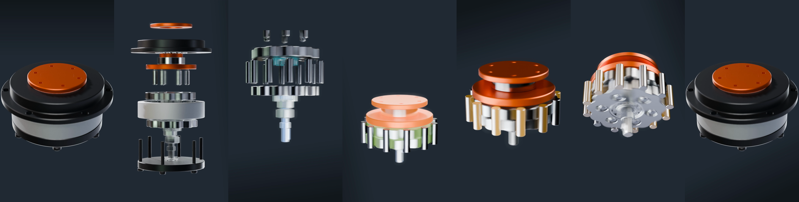
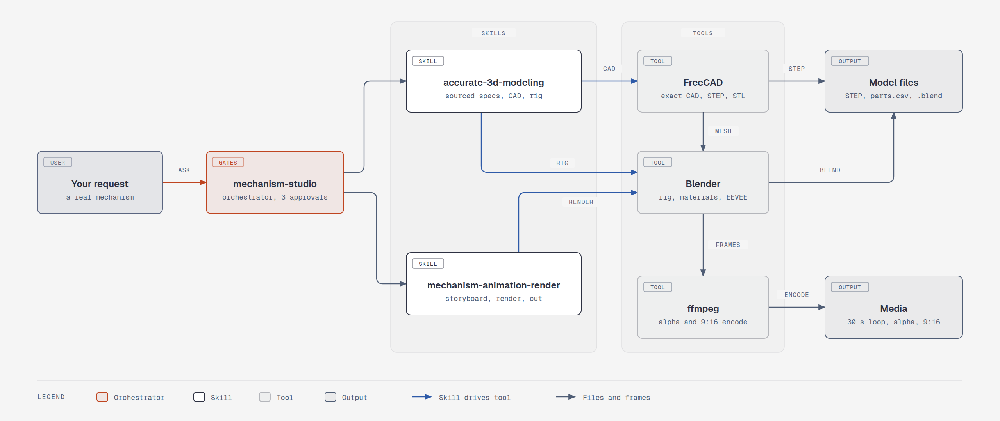
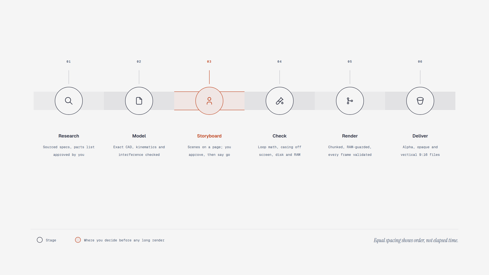

<div align="center">

# Mechanism skills for Claude Code

**Ask for a real mechanism. Get an exact, checked 3D model and a finished animation.**

Gearboxes, actuators, linkages, anything that moves, from sourced specs to a looping clip.

<a href="examples/cycloidal-drive"></a>

</div>

## What it does

You describe a mechanism, for example *"an 11:1 cycloidal drive, 64 mm pin circle, 1.5 mm eccentricity, and a 30 s animation of it"*. Claude then:

1. **Researches it** and writes every dimension down as sourced, derived or estimated, so you can see what is fact and what is a guess.
2. **Models it in CAD** from the real equations, checks the motion over a full cycle, and tests parts for collisions.
3. **Builds a rigged Blender model** with a single control, so the whole machine moves from one number.
4. **Storyboards the animation** and shows you key frames **before** any long render.
5. **Renders and delivers**: a loopable clip with a transparent background, a normal MP4, and a vertical 9:16 cut for Instagram and YouTube Shorts.

It stops and asks at the moments that matter: after the parts list, after the storyboard, and before the long render.

## How it fits together

<picture>
  <source media="(prefers-color-scheme: dark)" srcset="docs/diagrams/architecture-dark.png">
  
</picture>

Three skills, three open tools:

| | Role |
|---|---|
| `mechanism-studio` | The conductor. Runs the other two in order, with approval gates and a status file. |
| `accurate-3d-modeling` | Sourced specs, a parts list, parametric CAD in **FreeCAD**, motion and interference checks, a rigged **Blender** model. |
| `mechanism-animation-render` | Storyboard, camera, glow along the power path, casing removal with no pop-in, loopable speed ramps, chunked **Blender** render, **ffmpeg** encode. |

## The path, step by step

<picture>
  <source media="(prefers-color-scheme: dark)" srcset="docs/diagrams/steps-dark.png">
  
</picture>

## See it work

[`examples/cycloidal-drive`](examples/cycloidal-drive) has the finished vertical clip (a 30 s loop) and the numbers behind it: ring-pin gap 0.0000 mm, 12 of 12 pins in contact, 0.100 mm roller clearance, and 0 interferences at six poses.

## Why it is built this way

- **Exact where it matters.** Profiles come from equations and are checked numerically, not eyeballed.
- **Honest about what is a guess.** Anything illustrative (the pin load glow in the example) is labelled as such.
- **No surprises in the render.** It checks the loop, the speed (60 rpm out of an 11:1 drive is 132 degrees of input per frame, which aliases), and your disk and RAM before it starts. A long render once ran a machine out of memory, so it now renders in chunks and validates every frame.
- **You stay in control.** Nothing long runs until you say go.

## Install

```sh
cp -r skills/* ~/.claude/skills/
```

You need FreeCAD (`freecadcmd`), Blender 5.x, ffmpeg, and Python 3 with numpy and Pillow. Then ask for a mechanism and its animation in plain words.

## Status

Built and tested on one mechanism, the cycloidal drive. The modeling skill and the animation scripts are templates: the animation scripts have not yet been run on a second mechanism. A strain-wave (harmonic) drive or a planetary gearbox is the natural next test.

## Credits

The diagrams in this README were made with the [diagram-design](https://github.com/cathrynlavery/diagram-design) skill by Cathryn Lavery (MIT). The generator and the HTML sources are in [`docs/diagrams`](docs/diagrams).
