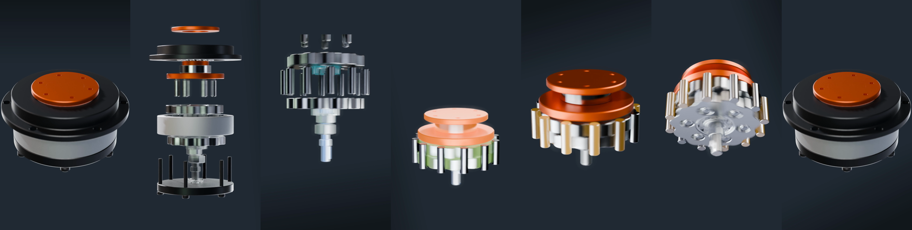

# Example: cycloidal drive

Made with `mechanism-studio` (the two skills in order).

[`cycloidal_vertical_9x16_instagram_youtube.mp4`](cycloidal_vertical_9x16_instagram_youtube.mp4): 1080x1920, 30 fps, 29.97 s loop, H.264, on a dark gradient (Instagram and YouTube have no alpha). The sequence goes exploded view, casing removed, a power-path fly-through where the glow runs cool to warm as torque builds, three angles of the assembly, an accelerate and decelerate, and reassembly back to the first frame.

The drive: single stage, 12 ring pins, 11 lobes (11:1), 64 mm pin circle, 6 mm pins, 1.5 mm eccentricity, two discs 180 degrees apart, 6 output pins with rollers. The disc profile is the offset epitrochoid, checked numerically: ring-pin gap 0.0000 mm, 12 of 12 pins in contact, roller-to-hole clearance 0.100 mm. Solid interference checks found 0 interferences at six poses.

Illustrative, not sourced: the amber glow on the ring pins is a sin-law load share I did not check against a published model. The speed (60 rpm out, 660 rpm in) aliases at 30 fps, so the shaft and cams read as a blur.

The CAD, Blender model and frames are not included in this repo.
